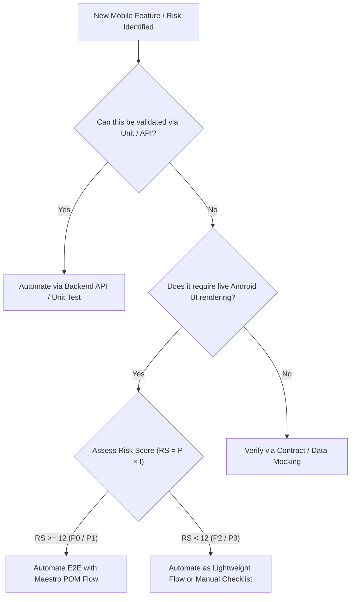
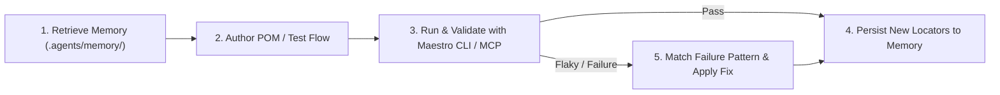

# Possaku Maestro Mobile Automation Architecture Guideline
## Page Object Model (POM) & Risk-Based Testing (RBT) Framework

> **Application**: Possaku Android Point of Sale (`com.cloudiex.possaku`)  
> **Author**: QA Automation Engineering Lead  
> **Target Toolchain**: Maestro CLI (v2.x) + Android SDK / Emulators + Maestro MCP + Python Step Injector  
> **Audience**: All AI Agents (High-tier & Low-tier) & Human Automation Engineers  

---

## 🤖 AI Agent Directive & Skill Integration

> [!IMPORTANT]
> **MANDATORY FOR ALL AI AGENTS**:
> Whenever you generate, edit, refactor, or debug any Maestro flow or Page Object in this repository, you **MUST** adhere to the rules in this document and consult the linked skill references and semantic memory bank below before writing code.

### Connected Skills & References (On-Demand Knowledge Base)
- **Primary Skill Entry Point**: [.agents/skills/maestro/SKILL.md](.agents/skills/maestro/SKILL.md)
- **Locator Strategies & Android Hierarchy**: [.agents/skills/maestro/references/locators.md](.agents/skills/maestro/references/locators.md)
- **Assertions & State Verifications**: [.agents/skills/maestro/references/assertions.md](.agents/skills/maestro/references/assertions.md)
- **POM & Script Separation (JS + YAML)**: [.agents/skills/maestro/references/pom-and-flows.md](.agents/skills/maestro/references/pom-and-flows.md)
- **Risk-Based Matrix & Tagging**: [.agents/skills/maestro/references/rbt-and-tagging.md](.agents/skills/maestro/references/rbt-and-tagging.md)
- **CI/CD, Runner & Step Traceability**: [.agents/skills/maestro/references/ci-and-debugging.md](.agents/skills/maestro/references/ci-and-debugging.md)
- **Maestro MCP Server Protocol**: [.agents/skills/maestro/references/mcp-integration.md](.agents/skills/maestro/references/mcp-integration.md)

### 🧠 Semantic Memory Bank (Domain Intelligence & Verified Locators)
- **Semantic Memory Registry**: [.agents/memory/MEMORY.md](.agents/memory/MEMORY.md)
- **Fast Lookup Index**: [.agents/memory/index.json](.agents/memory/index.json)
- **Verified Locators**:
  - [Kasir / Catalog / Cart / Checkout](.agents/memory/ui-locators/kasir.md)
  - [Auth / Login / PIN Pad](.agents/memory/ui-locators/auth.md)
  - [Dashboard / Metrics & Filters](.agents/memory/ui-locators/dashboard.md)
  - [Usahaku / Shift & Store Status](.agents/memory/ui-locators/usahaku.md)
  - [Daftar Pelanggan / Customers](.agents/memory/ui-locators/daftar-pelanggan.md)
  - [Lain-lain / Settings](.agents/memory/ui-locators/lain-lain.md)
- **Domain Entities & Business Rules**:
  - [POS Catalog & Variant Rules](.agents/memory/domains/pos-catalog.md)
  - [Cart Calculation & Payment Tender](.agents/memory/domains/cart-checkout.md)
  - [Store Shifts & Open/Close State](.agents/memory/domains/store-shifts.md)
  - [Possaku Auth & Accounts](.agents/memory/domains/auth-possaku.md)
- **Failure Patterns & Mobile Flakiness**:
  - [Soft Keyboard Obstruction](.agents/memory/failure-patterns/soft-keyboard-obstruction.md)
  - [ADB Device Connection & Restarts](.agents/memory/failure-patterns/device-connection.md)
  - [Lazy Rendering & Recycler Views](.agents/memory/failure-patterns/scroll-lazy-rendering.md)
  - [Step Traceability & inject_steps.py](.agents/memory/failure-patterns/step-traceability.md)
  - [Zero Hard Sleep & Dynamic Waiting](.agents/memory/failure-patterns/flakiness-and-timing.md)

---

## 🛑 Strict Rules for AI (Zero-Tolerance Checklist)

Any AI model generating code for this repository **MUST ALWAYS** obey these rules:

1. **NEVER use arbitrary sleeps or delay loops** (e.g., `pages/delay.js` or repetitive blank taps) — ALWAYS leverage Maestro's implicit waiting and conditional assertions like `assertVisible`.
2. **NEVER put scenario-level test assertions inside Page Objects** — `pages/` (JS and subflow YAMLs) only contain locators, reusable interactions, and local state readiness checks. All scenario pass/fail assertions belong strictly in `flows/`.
3. **NEVER hardcode raw UI locators directly inside flow files** — All selectors must be defined in `pages/<domain>/<domain>_page.js` and consumed via `${output.<page>.<element>}`.
4. **NEVER use brittle coordinate points when element locators exist** — Coordinate taps (`point: "X%, Y%"`) are strictly forbidden except for unexposed custom canvas/keypad inputs or relative scroll gestures.
5. **MANDATORY RISK TAGS in every Flow header** — Every single test flow file (`flows/<domain>/<name>_flow.yaml`) MUST declare tags matching our RBT matrix (`tags: [smoke, regression-p0, ...]`).
6. **STRICT SNAKE_CASE FILENAMES** — All file and folder names MUST use lowercase alphanumeric characters and underscores with explicit suffixes:
   - Page element files: `pages/<domain>/<name>_page.js`
   - Page subflow files: `pages/<domain>/<name>_flow.yaml`
   - Test scenario flows: `flows/<domain>/<name>_flow.yaml`
7. **MANDATORY NUMBERED TEST STEP COMMENTS** — Every test flow MUST be partitioned with explicit step comments (e.g. `# Step 1: Login with cashier account`, `# Step 2: Add catalog item to cart`) so that `inject_steps.py` can parse and display discrete step executions in `report.html`.
8. **MANDATORY SEMANTIC MEMORY USAGE** — ALWAYS cross-check `.agents/memory/ui-locators/` and `.agents/memory/domains/` before generating or modifying selectors. Update Semantic Memory immediately whenever new stable selectors or failure workarounds are established.
9. **ENVIRONMENT VARIABLES OVER HARDCODING** — Store credentials, URLs, and App IDs in `config/env.yaml` or pass them via `-e APP_ID=...`. Never hardcode raw phone numbers or PINs in test flows.
10. **NO RESIDUAL ARTIFACTS** — Clean up experimental flows, temporary screenshot files, or ad-hoc scripts after completing an analysis or implementation task.
11. **OFFLINE MODE RESTORATION MANDATE** — Any test scenario that tests Offline Mode using `toggleAirplaneMode` MUST toggle it back online before terminating. All runner scripts (`run_detailed_test.sh`, `run_suite.sh`) enforce an automatic ADB network trap (`trap ensure_online EXIT INT TERM`) to guarantee that Airplane Mode is disabled and Wi-Fi / cellular data are re-enabled both before and after execution, even if a test crashes or is cancelled. A standalone utility `./restore_internet.sh` is provided for manual network recovery.

---

## 1. Risk-Based Testing (RBT) Framework

Risk-Based Testing prioritizes mobile POS test automation based on financial risk, transactional impact, and likelihood of regression.

### 1.1 Risk Scoring Formula
$$\text{Risk Score (RS)} = \text{Probability of Failure (P: 1-5)} \times \text{Business Impact (I: 1-5)}$$

| Probability (P) Criteria | Impact (I) Criteria |
| :--- | :--- |
| **5**: High code churn / frequent native layout changes / complex payment integrations | **5**: Financial transaction blocker / Cash drawer discrepancy / Crash on order |
| **4**: Complex calculation logic (Discounts, Tax, Quantity decimals) | **4**: Core user journey broken (Catalog selection, Cart checkout, Login) |
| **3**: Moderate complexity / multi-step forms (Customer creation, Store settings) | **3**: Feature impaired with workaround available (Filters, Search) |
| **2**: Minor UI features / stable display screens | **2**: Cosmetic / Text label truncation / Non-blocking UI glitch |
| **1**: Static display / About screen | **1**: Edge case with negligible user reach |

---

### 1.2 Test Classification & Tagging Matrix

| Tier | Tag | Risk Score Range | Execution Trigger | SLA / Target Run Time | Automation Focus |
| :--- | :--- | :--- | :--- | :--- | :--- |
| **P0: Critical** | `smoke`, `regression-p0` | $20 - 25$ | Every PR / Pre-release build | $< 5$ minutes | Cashier Login, Open Store, Catalog Add to Cart, Cash Payment |
| **P1: High** | `regression-p1`, `core` | $12 - 19$ | Nightly regression suite | $< 20$ minutes | Variant adjustments, Cart quantity editing, Discounts, Close Store |
| **P2: Medium** | `regression-p2`, `extended` | $6 - 11$ | Scheduled / Weekly runs | $< 40$ minutes | Customer directory CRUD, Dashboard date filters, Online store settings |
| **P3: Low** | `low`, `edge` | $1 - 5$ | On-demand / Exploratory | Ad-hoc | Edge cases, network recovery, deep settings configurations |
| **Special** | `quarantine`, `flaky` | N/A | Excluded from blocking CI | Ad-hoc / Diagnostic | Failing tests under investigation (Max 7-day TTL) |

---

### 1.3 The Mobile Automation Feasibility Filter



---

## 2. Directory Structure & Domain Symmetry

The test suite enforces **1-to-1 Domain Symmetry** between the Possaku Mobile App navigation sections, `pages/`, and `flows/`:

```text
Possaku_maestro/
├── README.md                                    # Project Overview & Execution Guide
├── AGENTS.md                                    # Canonical AI Directive & Architecture Guideline
├── .agents/                                     # Machine Intelligence Knowledge Base
│   ├── rules/
│   │   ├── maestro-standards.md                 # Enforced Maestro rules
│   │   └── test-case-naming.md                  # Test case ID & prefix standards
│   ├── skills/
│   │   └── maestro/                             # Token-optimized Maestro automation skill
│   │       ├── SKILL.md
│   │       └── references/
│   └── memory/                                  # Semantic Memory Bank
│       ├── MEMORY.md                            # Memory protocol & registry
│       ├── index.json                           # Fast lookup keyword index
│       ├── ui-locators/                         # Screen-specific verified locators
│       ├── domains/                             # POS domain entities & business logic
│       └── failure-patterns/                    # Verified mobile failure fixes
├── config/
│   └── env.yaml                                 # Environment credentials & app ID
├── pages/                                       # Page Object Model Layer (Locators & Subflows)
│   ├── login/
│   │   ├── login_credential.js                  # Test credentials definition
│   │   ├── login_page.js                        # Login locators
│   │   └── ensure_logged_in.yaml                # Reusable login subflow
│   ├── kasir/
│   ├── dashboard/
│   ├── usahaku/
│   ├── daftar_pelanggan/
│   ├── daftar_pesanan/
│   ├── keuangan/
│   ├── atur_produk/
│   ├── lain_lain/                               # Per-feature Page Objects & Helpers
│   │   ├── cetak_struk/
│   │   ├── toko_online/
│   │   ├── daftar_karyawan/
│   │   └── multi_usaha/
│   └── helpers/
├── flows/                                       # Scenario Layer (Executable Test Flows)
│   ├── login/
│   ├── kasir/
│   ├── dashboard/
│   ├── usahaku/
│   ├── daftar_pelanggan/
│   ├── daftar_pesanan/
│   ├── keuangan/
│   ├── atur_produk/
│   └── lain_lain/                               # Per-feature Flow Suites
│       ├── cetak_struk/
│       ├── toko_online/
│       ├── daftar_karyawan/
│       └── multi_usaha/
├── test_plans/                                  # Feature Test Plans & Automation Matrices
│   └── lain_lain/
├── reports/                                     # Playwright-Style HTML Test Reports
├── .maestro/
│   └── regression_suite.yaml                    # Master suite definition
├── inject_steps.py                              # Playwright-style HTML report generator & step enricher
├── run_detailed_test.sh                         # Test runner generating per-step screenshots & HTML report
└── run_suite.sh                                 # Batch test runner
```

---

## 3. Standardized Implementation Blueprints

### Blueprint A: Page Object Model (`pages/<domain>/<name>_page.js`)
```javascript
output.kasir_page = {
  // Navigation
  kasirMenuButton: "Kasir\n",

  // Catalog / Products
  searchFieldHint: "Cari produk",
  productRegularText: "O1\no1\nRp12.000\n1 Varian",
  variantReguler: "Reguler.*",
  variantSheetAdd: "Tambahkan",
  variantSheetQtyPlus: "+",

  // Cart Modal
  cartButtonRegex: "Keranjang.*",
  cartPayButton: "Bayar"
};
```

### Blueprint B: Reusable Subflow (`pages/<domain>/<name>_flow.yaml`)
```yaml
appId: ${APP_ID}
---
# Action: Execute Login Subflow
- tapOn:
    id: "${output.login_page.phoneInputField}"
- inputText: "${phoneNumber}"

- tapOn:
    id: "${output.login_page.submitButton}"

- assertVisible:
    text: "${expectedToast}"
```

### Blueprint C: Executable Test Flow (`flows/<domain>/<name>_flow.yaml`)
```yaml
appId: ${APP_ID}
tags:
  - regression-p0
  - kasir
  - catalog
---
# Load Page Objects & Credentials
- runScript:
    file: ../../pages/login/login_credential.js
- runScript:
    file: ../../pages/login/login_page.js
- runScript:
    file: ../../pages/kasir/kasir_page.js

# Step 1: Precondition - Login to Possaku App
- runFlow:
    file: ../../pages/login/login_flow.yaml
    env:
      phoneNumber: "${output.login_credential.dev.validPhoneNumber2}"
      PIN: "${output.login_credential.dev.validPIN}"
      expected1: ".*Selamat datang.*"

# Step 2: Navigate to Kasir Screen
- tapOn:
    text: "Mengerti"
    optional: true
- tapOn: "${output.kasir_page.kasirMenuButton}"

# Step 3: Add Regular Product to Cart
- tapOn: "${output.kasir_page.productRegularText}"
- tapOn: "${output.kasir_page.variantReguler}"
- tapOn: "${output.kasir_page.variantSheetAdd}"

# Step 4: Validate Cart Counter Assertion
- assertVisible: "Keranjang \\(1\\)"
```

---

## 4. Semantic Memory Closed-Loop Workflow

All AI agents and engineers operate in a **closed-loop memory cycle**:



1. **Retrieve**: Read `.agents/memory/ui-locators/` and `.agents/memory/domains/` before generating selectors.
2. **Author**: Follow Blueprints A–C with strict RBT tags and explicit numbered step comments.
3. **Execute**: Run or check syntax using `maestro check-syntax` or Maestro MCP tools.
4. **Self-Heal**: If timing or rendering issues occur, consult `.agents/memory/failure-patterns/`.
5. **Persist**: Update `.agents/memory/` whenever new selectors, screen layouts, or failure mitigations are identified.

---

## 5. Pre-Flight Self-Verification Checklist

Before submitting code, all AI models and engineers must self-verify:
- [ ] Were locators verified against Semantic Memory (`.agents/memory/ui-locators/`)?
- [ ] Are all filenames strictly `snake_case` with explicit suffixes (`_page.js`, `_flow.yaml`)?
- [ ] Are Page Objects free of scenario-level pass/fail assertions?
- [ ] Does every flow declare RBT tags (`smoke`, `regression-p0`, `regression-p1`, etc.)?
- [ ] Is every test scenario structured into numbered step comments (`# Step N: ...`)?
- [ ] Are raw selectors avoided in flows in favor of `${output.<page>.<element>}`?
- [ ] Are there zero arbitrary sleep delays (`delay.js`) in the flow?
- [ ] Did you validate the syntax using `maestro check-syntax <flow.yaml>`?
- [ ] If a newly discovered element or failure pattern was resolved, was Semantic Memory updated?

---

## 6. CI/CD Standards & Headless Runner Guidelines

All automated flows run seamlessly in both local environments and remote GitHub Actions CI:

1. **Dynamic Device Targeting**: Runner scripts (`run_detailed_test.sh`, `run_suite.sh`) dynamically detect active devices (`adb devices`), honoring `$DEVICE_TARGET` or `$DEVICE` without hardcoding `emulator-5554`.
2. **Network Safety Guarantee**: Any flow testing offline behavior (e.g. `toggleAirplaneMode`) MUST rely on runner `trap ensure_online` or `restore_internet.sh` to prevent subsequent tests from running in offline mode.
3. **Zero External Dependencies**: Report enrichment tools (`inject_steps.py`, `generate_ci_summary.py`) must run using Python's standard library alone so runners require no `pip install` overhead.
4. **GitHub Actions Workflow**: Canonical workflow is at `.github/workflows/maestro_regression.yml`, utilizing Linux (`ubuntu-latest`) runners with KVM hardware virtualization and `reactivecircus/android-emulator-runner@v2` on API 30 with automated Step Summaries and Playwright HTML report artifact uploads.

