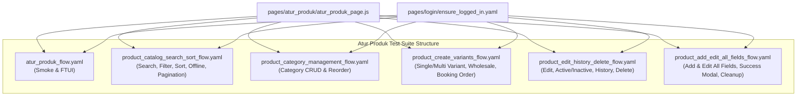

# Comprehensive Test Plan: Atur Produk (`flows/atur_produk/`)

## 1. Overview & Directory Structure
This test plan provides complete, 100% coverage for the **Atur Produk** module in Possaku, incorporating all 31 user-specified scenarios plus full regression coverage.

- **Flows Folder**: `flows/atur_produk/`
  - `atur_produk_flow.yaml` — Smoke test: Open Atur Produk from Dashboard, dismiss coachmarks, verify catalog header & tabs, return to Dashboard.
  - `product_catalog_search_sort_flow.yaml` — Search, all sorting modes (Alphabet ASC/DESC, Stock ASC/DESC, Active/Inactive), category display, pagination, and offline mode.
  - `product_category_management_flow.yaml` — Category CRUD & reordering: Add, Edit, Delete, Save Category order, and drag-and-drop sort order.
  - `product_create_variants_flow.yaml` — Single variant (pro), multiple variants, wholesale price (`Harga Grosir`), Booking Order product & Add-on purchase.
  - `product_edit_history_delete_flow.yaml` — Edit product detail, toggle status (active/inactive), view/share/download product history, and delete product with confirmation.
  - `product_add_edit_all_fields_flow.yaml` — Add product with all fields filled (Toko, Kategori, Nama, Satuan, Stok, Desimal, Harga Jual, Harga Modal, Barcode), handle success screen, edit product details and status, cleanup delete, and return to dashboard.
- **Page Object Model**: `pages/atur_produk/atur_produk_page.js`
  - Verified UI selectors for Catalog, Sort Bottom Sheet, Kategori Produk, Tambah Produk form, Detail Produk, Overflow menus, and Riwayat Produk.

---

## 2. Test Case Coverage Matrix (100% User List Mapped)

| # | User Request Test Case | Test Case ID | Target Flow | Priority | Description & Validation |
| :---: | :--- | :---: | :--- | :---: | :--- |
| 1 | **Finish FTUI** | `AP-01` | `atur_produk_flow.yaml` | P0 | Completes First-Time User Interface coachmarks/onboarding (`Lewati` / `Selesai` / `Lanjutkan`) upon opening Atur Produk. |
| 2 | **Add product with single varian (pro only)** | `AP-02` | `product_create_variants_flow.yaml` | P0 | Creates a standard single-variant product with required fields (`Nama Produk`, `Harga Jual`, `Harga Modal`, `Jumlah Stok`). |
| 3 | **Add product with multiple varian** | `AP-03` | `product_create_variants_flow.yaml` | P0 | Taps `+ Tambah Varian` to add >=2 variants with different names, prices, and stock; verifies catalog shows `\d+ Varian`. |
| 4 | **Add product with wholesale price (harga grosir)** | `AP-04` | `product_create_variants_flow.yaml` | P1 | Enables `Aktifkan Harga Grosir` checkbox, configures minimum quantity and tiered pricing, saves, and verifies wholesale settings. |
| 5 | **Search product** | `AP-05` | `product_catalog_search_sort_flow.yaml` | P0 | Taps search icon (`785,252`), enters query (`beras`), verifies matching item displays; clears or searches non-existent query to verify empty state. |
| 6 | **Sort Product by highest stock** | `AP-06` | `product_catalog_search_sort_flow.yaml` | P1 | Taps Sort (`975,250`) -> `Stok Terbanyak`; asserts list reorders by descending stock count. |
| 7 | **Sort Product by lowest stock** | `AP-07` | `product_catalog_search_sort_flow.yaml` | P1 | Taps Sort -> `Stok Terendah`; asserts list reorders by ascending stock count. |
| 8 | **Sort Product by alphabet ASC** | `AP-08` | `product_catalog_search_sort_flow.yaml` | P1 | Taps Sort -> `Alfabet A-Z`; asserts products displayed in alphabetical order A-Z. |
| 9 | **Sort Product by alphabet DESC** | `AP-09` | `product_catalog_search_sort_flow.yaml` | P1 | Taps Sort -> `Alfabet Z-A`; asserts products displayed in reverse alphabetical order Z-A. |
| 10 | **Show product by category appear** | `AP-10` | `product_catalog_search_sort_flow.yaml` | P0 | Taps category pill (e.g., `Sembako (\d+)`); asserts only products associated with that category appear. |
| 11 | **Edit Product detail** | `AP-11` | `product_edit_history_delete_flow.yaml` | P0 | Taps product card -> `Detail Produk`, updates field (`Nama Produk` / price), taps `Perbarui Informasi`; verifies update in catalog. |
| 12 | **Change product status (active/inactive)** | `AP-12` | `product_edit_history_delete_flow.yaml` | P0 | On `Detail Produk`, toggles `Status Produk` switch (`Aktif` &harr; `Non-Aktif`), taps `Perbarui Informasi`; verifies badge in Atur Produk & visibility in Kasir. |
| 13 | **Delete product** | `AP-13` | `product_edit_history_delete_flow.yaml` | P0 | On `Detail Produk`, taps `⋮` (`996,136`) -> `Hapus Produk`; asserts `Konfirmasi Yakin akan menghapus...`; verifies deletion upon tapping `Ya` (or cancelled on `Tidak`). |
| 14 | **Add category** | `AP-14` | `product_category_management_flow.yaml` | P1 | Opens `⋮` -> `Kategori Produk`; adds new category name and assigns to catalog. |
| 15 | **Edit category** | `AP-15` | `product_category_management_flow.yaml` | P1 | In `Kategori Produk`, edits existing category name; verifies updated category name across Atur Produk tabs and Kasir. |
| 16 | **Delete category** | `AP-16` | `product_category_management_flow.yaml` | P1 | In `Kategori Produk`, deletes category; verifies handling of products under that category and tab removal. |
| 17 | **Save Category** | `AP-17` | `product_category_management_flow.yaml` | P1 | In `Kategori Produk`, taps `Simpan` button (`[53,1592][1028,1742]`); verifies category list changes persist. |
| 18 | **Change sort category** | `AP-18` | `product_category_management_flow.yaml` | P1 | Reorders categories in `Kategori Produk` (drag up/down instruction); taps `Simpan`; verifies category tabs in Kasir and Atur Produk reflect new order. |
| 19 | **View product history** | `AP-19` | `product_edit_history_delete_flow.yaml` | P1 | On `Detail Produk`, taps `⋮` -> `Riwayat Produk`; asserts `Dimasukkan Etalase`, `Update Terakhir`, and timeline data. |
| 20 | **Share product history** | `AP-20` | `product_edit_history_delete_flow.yaml` | P2 | In `Riwayat Produk`, taps `Share` option; verifies native Android share intent / dialog triggers without error. |
| 21 | **Download product history** | `AP-21` | `product_edit_history_delete_flow.yaml` | P2 | In `Riwayat Produk`, taps `Download` option; verifies export file generation / toast confirmation. |
| 22 | **Pagination data** | `AP-22` | `product_catalog_search_sort_flow.yaml` | P1 | In catalog with high product count, scrolls downward (`swipe: 50%,80% to 50%,20%`); asserts lazy loading / next page data renders smoothly. |
| 23 | **Add booking order product** | `AP-23` | `product_create_variants_flow.yaml` | P1 | In `Tambah Produk`, inspects `Fitur Booking Order`; creates a product designated for booking order scheduling. |
| 24 | **Buy add on booking order product** | `AP-24` | `product_create_variants_flow.yaml` | P2 | In `Tambah Produk`, taps `Beli Add-on` under `Fitur Booking Order` (`Rp75.000/bulan`); verifies subscription checkout sheet opens cleanly. |
| 25 | **Offline Mode** | `AP-25` | `product_catalog_search_sort_flow.yaml` | P1 | Uses `toggleAirplaneMode`; asserts cached products remain browseable and searchable offline; toggles back online. |
| 26 | **Sorting based on alphabet ascending** | `AP-26` | `product_catalog_search_sort_flow.yaml` | P1 | Taps Sort -> `Alfabet A-Z`; asserts products ordered ascending by title. |
| 27 | **Sorting based on alphabet descending** | `AP-27` | `product_catalog_search_sort_flow.yaml` | P1 | Taps Sort -> `Alfabet Z-A`; asserts products ordered descending by title. |
| 28 | **Sorting based on stock ascending** | `AP-28` | `product_catalog_search_sort_flow.yaml` | P1 | Taps Sort -> `Stok Terendah`; asserts lowest stock items appear first. |
| 29 | **Sorting based on stock descending** | `AP-29` | `product_catalog_search_sort_flow.yaml` | P1 | Taps Sort -> `Stok Terbanyak`; asserts highest stock items appear first. |
| 30 | **Sorting based on active product** | `AP-30` / `PROD-27` | `product_catalog_search_sort_flow.yaml` | P1 | Taps Sort -> `Produk Aktif`; asserts only `Aktif` products appear in the list. |
| 31 | **Sorting based on inactive product** | `AP-31` / `PROD-28` | `product_catalog_search_sort_flow.yaml` | P1 | Taps Sort -> `Produk Non Aktif`; asserts only `Non-Aktif` products appear in the list. |
| 32 | **Add product with all fields filled** | `PROD-30` | `product_add_edit_all_fields_flow.yaml` | P0 | Selects Toko (`new ref wija`), Kategori (`Sembako`), enters Nama (`Kopi Luwak Premium`), Satuan (`Pcs`), Stok (`100`), enables Desimal, Harga Jual (`Rp50.000`), Harga Modal (`Rp30.000`), Barcode (`8991234567890`), confirms save, asserts success screen (`Ke Halaman beranda`), and verifies product in catalog. |
| 33 | **Edit product with all fields updated** | `PROD-31` | `product_add_edit_all_fields_flow.yaml` | P0 | Opens created product, toggles status switch (`Aktif` <-> `Non-Aktif`), edits name (`Kopi Luwak Istimewa`), taps `Perbarui Informasi`, confirms, and verifies updated card in catalog. |
| 34 | **Clean up (Delete edited test product)** | `PROD-32` | `product_add_edit_all_fields_flow.yaml` | P1 | Opens edited product, taps overflow `⋮`, selects `Hapus Produk`, confirms `Ya`, and asserts catalog returns to base state. |
| 35 | **Return to Dashboard from Atur Produk** | `PROD-33` | `product_add_edit_all_fields_flow.yaml` | P1 | Taps `Kembali` to return to home dashboard and verifies `Overview` widget is visible. |

---

## 3. Architecture & Execution Flow



---

## 4. Test Execution Commands

Run single smoke flow:
```bash
./run_detailed_test.sh flows/atur_produk/atur_produk_flow.yaml atur_produk_smoke_report.html
```

Run entire Atur Produk suite:
```bash
./run_detailed_test.sh flows/atur_produk/ atur_produk_full_suite_report.html
```
