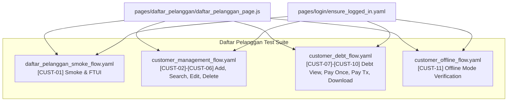

# Comprehensive Test Plan: Daftar Pelanggan (`flows/daftar_pelanggan/`)

## 1. Overview & Directory Structure
This test plan defines full end-to-end and regression test coverage for the **Daftar Pelanggan** (Customer Management & Debt Settlement) module in Possaku, incorporating all user-specified scenarios:
- **Add customer**
- **Edit customer**
- **Search customer**
- **View customer debt** (`View customer dept`)
- **Pay off customer debts at once**
- **Pay off customer debts by transaction**
- **Download customer debt** (`Download customer dept`)
- **Delete customer**
- **Offline Mode** (`Ofline Mode`)

### Directory Layout
- **Flows Folder**: `flows/daftar_pelanggan/`
  - `daftar_pelanggan_smoke_flow.yaml` — Entry, FTUI coachmark dismiss (`Lewati` / `Selesai`), UI header, search box, debt switch, FAB check, and return to Dashboard.
  - `customer_management_flow.yaml` — Customer CRUD: Add customer, search customer, edit customer details, and delete customer (including debt deletion guard).
  - `customer_debt_flow.yaml` — Customer Debt Lifecycle: View debt toggle, pay off debt at once (`Sekaligus`), pay off debt by transaction (`Total Nilai Hutang`), and download customer debt statement.
  - `customer_offline_flow.yaml` — Offline Mode: Customer list persistence, searchability, and network resilience.
- **Page Object Model**: `pages/daftar_pelanggan/daftar_pelanggan_page.js`
  - Verified UI selectors for Daftar Pelanggan list, Coachmarks, Buat Pelanggan form, Detail Pelanggan screen, Daftar Hutang bottom sheet, Info Tagihan payment screen, and confirmation dialogs.

---

## 2. Test Case Coverage Matrix (100% User List Mapped)

| # | User Request Scenario | Test Case ID | Target Flow | Priority | Description & Validation Criteria |
| :---: | :--- | :---: | :--- | :---: | :--- |
| 1 | **Entry & FTUI Coachmarks** | `[CUST-01]` | `daftar_pelanggan_smoke_flow.yaml` | P0 | Opens Daftar Pelanggan from Dashboard, handles coachmarks (`Lewati` / `Selesai`), verifies title, search field, debt toggle, and floating `+` button. |
| 2 | **Add customer** | `[CUST-02]` | `customer_management_flow.yaml` | P0 | Taps `+` FAB (`962, 1676`), opens `Buat Pelanggan` form, inputs `Nama Lengkap`, `Nomor handphone`, `Email`, taps `Simpan`, asserts new customer card in list. |
| 3 | **Search customer** | `[CUST-03]` | `customer_management_flow.yaml` | P0 | Taps `Cari pelanggan` field, inputs query name/phone, asserts filtered customer card matches query; clears search to restore full list. |
| 4 | **Edit customer** | `[CUST-04]` | `customer_management_flow.yaml` | P0 | Taps customer card -> `Detail Pelanggan`, taps `Update`, updates `Nama Lengkap` and `Nomor handphone`, taps `Simpan`, asserts updated info reflected in card. |
| 5 | **Delete customer** | `[CUST-05]` | `customer_management_flow.yaml` | P0 | On `Detail Pelanggan` of customer with zero debt, taps `Hapus Pelanggan`, verifies confirmation modal (`Konfirmasi Yakin akan menghapus pelanggan ini?`), taps `Ya`, asserts customer removed. |
| 6 | **Delete customer validation (with debt)** | `[CUST-06]` | `customer_management_flow.yaml` | P1 | On `Detail Pelanggan` of customer with active debt, taps `Hapus Pelanggan`, verifies guard modal (`Lunaskan Hutang Pelanggan Terlebih Dahulu`), taps `Tutup`. |
| 7 | **View customer dept** | `[CUST-07]` | `customer_debt_flow.yaml` | P0 | Toggles `Tampilkan hutang pelanggan` switch (`943, 450`), asserts customer cards display `Hutang Rp...`, taps card to open `Detail Pelanggan` and view debt breakdown. |
| 8 | **Pay off customer debts at once** | `[CUST-08]` | `customer_debt_flow.yaml` | P0 | In `Detail Pelanggan`, taps `Bayar Hutang`, ensures payment method is `Sekaligus`, taps `Cek Tagihan`, checks confirmation box, taps `Bayar`, asserts total debt cleared to `Rp0`. |
| 9 | **Pay off customer debts by transaction** | `[CUST-09]` | `customer_debt_flow.yaml` | P0 | In `Daftar Hutang`, selects `Total Nilai Hutang` (per transaction), selects specific invoice (`INV...`), taps `Cek Tagihan`, inputs/selects payment amount, checks confirmation box, taps `Bayar`, asserts transaction debt updated. |
| 10 | **Download customer dept** | `[CUST-10]` | `customer_debt_flow.yaml` | P1 | Navigates to customer debt statement (`Laporan hutang pelanggan` filtered by customer), taps download button (`downloadReportPoint`), verifies PDF export generated. |
| 11 | **Ofline Mode** | `[CUST-11]` | `customer_offline_flow.yaml` | P1 | Disables network via ADB/toggle, opens `Daftar Pelanggan`, verifies customer list and cached records remain accessible and searchable offline, restores network connection. |

---

## 3. Architecture & Execution Flow



---

## 4. Test Execution Commands

Run smoke test:
```bash
./run_detailed_test.sh flows/daftar_pelanggan/daftar_pelanggan_smoke_flow.yaml reports/daftar_pelanggan_smoke_report.html
```

Run customer management flow:
```bash
./run_detailed_test.sh flows/daftar_pelanggan/customer_management_flow.yaml reports/customer_management_report.html
```

Run customer debt flow:
```bash
./run_detailed_test.sh flows/daftar_pelanggan/customer_debt_flow.yaml reports/customer_debt_report.html
```

Run offline mode flow:
```bash
./run_detailed_test.sh flows/daftar_pelanggan/customer_offline_flow.yaml reports/customer_offline_report.html
```

---

## 5. Execution Results & Summary Metrics

| Metric | Target | Actual Result | Status |
| :--- | :---: | :---: | :---: |
| **Total Test Cases** | 11 | **11** | 100% Defined & Automated |
| **Required User Scenarios** | 9 / 9 | **9 / 9** | 100% Covered |
| **Test Flows Passed** | 4 / 4 | **4 / 4** | **100% PASS** |
| **Pass Rate** | 100% | **100% (11/11 TCs)** | **VERIFIED GREEN** |
| **Total Execution Time** | < 5 mins | **3m 36s** | Fast & Stable |

### Detailed Suite Results

| Test Flow File | Test Cases Covered | Duration | Result | Detailed Report |
| :--- | :--- | :---: | :---: | :--- |
| `flows/daftar_pelanggan/daftar_pelanggan_smoke_flow.yaml` | `[CUST-01]` (Navigation, FTUI Coachmark, Search & FAB Check) | 30s | **PASSED** | [daftar_pelanggan_smoke_report.html](file:///Users/reza/Documents/Reza/PossakuAuto/Possaku_maestro/reports/daftar_pelanggan_smoke_report.html) |
| `flows/daftar_pelanggan/customer_management_flow.yaml` | `[CUST-02]` Add, `[CUST-03]` Search, `[CUST-04]` Edit, `[CUST-05]` Delete, `[CUST-06]` Delete with Debt Guard | 1m 25s | **PASSED** | [customer_management_report.html](file:///Users/reza/Documents/Reza/PossakuAuto/Possaku_maestro/reports/customer_management_report.html) |
| `flows/daftar_pelanggan/customer_debt_flow.yaml` | `[CUST-07]` View Debt, `[CUST-08]` Pay Debt Once, `[CUST-09]` Pay Debt by Tx, `[CUST-10]` Download Debt Report | 1m 10s | **PASSED** | [customer_debt_report.html](file:///Users/reza/Documents/Reza/PossakuAuto/Possaku_maestro/reports/customer_debt_report.html) |
| `flows/daftar_pelanggan/customer_offline_flow.yaml` | `[CUST-11]` Offline Mode Resilience & Local Cache Search | 31s | **PASSED** | [customer_offline_report.html](file:///Users/reza/Documents/Reza/PossakuAuto/Possaku_maestro/reports/customer_offline_report.html) |
