# Comprehensive Test Plan: Daftar Pesanan (`flows/daftar_pesanan/`)

## 1. Overview & Scope
This test plan provides comprehensive automated end-to-end test coverage for the **Daftar Pesanan** (Order List & Queue Management) module in Possaku. It integrates all 17 user-requested scenarios and operational edge cases:

- **Filter Tahun ini**
- **Filter Tahun lalu**
- **Filter bulan lalu**
- **Filter bulan ini**
- **Filter custom**
- **Filter All** (`Semua`)
- **Filter Paid** (`Terbayar`)
- **Filter Unpaid** (`Belum Terbayar`)
- **Search Queue** (`Cari Antrian`)
- **Finish Queue** (`Selesai`)
- **Edit Note** (`Catatan Pesanan`)
- **Edit Order** (`Ubah Pesanan`)
- **Print Pesanan**
- **Print Bill**
- **Tagih** (Payment Trigger)
- **Reset nomor antrian**
- **Refresh button** (`Rerfresh button`)

---

## 2. Directory Architecture & File Structure

```
Possaku_maestro/
├── pages/
│   └── daftar_pesanan/
│       └── daftar_pesanan_page.js         # Page Object with verified selectors & touchpoints
├── flows/
│   └── daftar_pesanan/
│       ├── order_smoke_flow.yaml          # Smoke, Navigation, Info Modal & Refresh
│       ├── order_status_filter_flow.yaml  # All, Paid, Unpaid filter tabs & Search Queue
│       ├── order_period_filter_flow.yaml  # Year, Month, Custom date filter modal
│       ├── order_action_flow.yaml         # Edit Note, Edit Order, Print Pesanan/Bill, Tagih, Finish Queue
│       └── order_queue_reset_flow.yaml    # Reset Nomor Antrian lifecycle & confirmation dialogs
└── test_plans/
    └── daftar_pesanan_comprehensive_test_plan.md # Workspace copy of test plan
```

---

## 3. Test Case Coverage Matrix (100% User List Mapped)

All test cases adhere strictly to the naming convention `# [ORDER-XX]`:

| # | User Request Feature | Test Case ID | Target Flow | Priority | Description & Validation Criteria |
| :---: | :--- | :---: | :--- | :---: | :--- |
| 1 | **Navigation & Smoke** | `[ORDER-01]` | `order_smoke_flow.yaml` | P0 | Navigates from Dashboard to Daftar Pesanan via `Daftar\nPesanan.*` grid tile; asserts header title `Daftar Pesanan`, status tabs, and back navigation. |
| 2 | **Refresh button** (`Rerfresh button`) | `[ORDER-02]` | `order_smoke_flow.yaml` | P1 | Taps the top-bar Refresh icon (`point: "911, 136"`); verifies queue list reloads without error or UI stutter. |
| 3 | **Info Modal / Guidelines** | `[ORDER-03]` | `order_smoke_flow.yaml` | P2 | Taps the top-bar Info icon (`point: "996, 136"`); verifies modal `Daftar Pesanan menampilkan semua transaksi aktif...`, taps `Tutup`. |
| 4 | **Filter All** | `[ORDER-04]` | `order_status_filter_flow.yaml` | P0 | Taps `Semua` tab (`point: "147, 301"`); asserts all active orders (both paid and unpaid) are listed. |
| 5 | **Filter Paid** | `[ORDER-05]` | `order_status_filter_flow.yaml` | P0 | Taps `Terbayar` tab (`point: "374, 301"`); asserts only paid completed/processing orders are listed or empty state displays correctly. |
| 6 | **Filter Unpaid** | `[ORDER-06]` | `order_status_filter_flow.yaml` | P0 | Taps `Belum Terbayar` tab (`point: "642, 301"`); asserts only orders with pending payments (`Belum Bayar`) are shown. |
| 7 | **Search Queue** | `[ORDER-07]` | `order_status_filter_flow.yaml` | P0 | Taps search icon (`point: "848, 301"`), inputs query into `Cari Antrian` field, asserts filtered queue cards match; taps `Tutup` to restore full list. |
| 8 | **Filter Tahun ini** | `[ORDER-08]` | `order_period_filter_flow.yaml` | P1 | Opens `Filter Periode` (`point: "975, 301"`), selects chip `Tahun ini`, taps `Terapkan Filter`; asserts list refreshes to current year records. |
| 9 | **Filter Tahun lalu** | `[ORDER-09]` | `order_period_filter_flow.yaml` | P1 | Opens `Filter Periode`, scrolls chips, selects `Tahun lalu`, taps `Terapkan Filter`; asserts historic queue orders load. |
| 10 | **Filter bulan lalu** | `[ORDER-10]` | `order_period_filter_flow.yaml` | P1 | Opens `Filter Periode`, scrolls chips, selects `Bulan lalu`, taps `Terapkan Filter`; verifies orders from previous month load. |
| 11 | **Filter bulan ini** | `[ORDER-11]` | `order_period_filter_flow.yaml` | P0 | Opens `Filter Periode`, selects `Bulan ini`, taps `Terapkan Filter`; verifies active current month orders load. |
| 12 | **Filter custom** | `[ORDER-12]` | `order_period_filter_flow.yaml` | P1 | Opens `Filter Periode`, selects `Kustom`, selects start/end calendar dates, taps `Terapkan Filter`; verifies custom range results. |
| 13 | **Edit Order** | `[ORDER-13]` | `order_action_flow.yaml` | P0 | Taps 3-dots on order card (`point: "943, 504"`), taps `Ubah Pesanan`, asserts `Ubah Pesanan` screen opens with customer name & product list, taps `Simpan`. |
| 14 | **Edit Note** | `[ORDER-14]` | `order_action_flow.yaml` | P0 | In `Ubah Pesanan`, taps `Catatan Pesanan`, updates note text, taps `Simpan`, verifies updated note reflected on order card. |
| 15 | **Print Pesanan** | `[ORDER-15]` | `order_action_flow.yaml` | P1 | Taps 3-dots on order card, taps `Print Pesanan` (`point: "540, 1345"`), asserts print execution/printer feedback without crashing. |
| 16 | **Print Bill** | `[ORDER-16]` | `order_action_flow.yaml` | P1 | Taps 3-dots on order card, taps `Print Bill` (`point: "540, 1508"`), asserts receipt bill format print dialog/dispatch. |
| 17 | **Tagih** | `[ORDER-17]` | `order_action_flow.yaml` | P0 | On an unpaid order card, taps `Tagih` (`point: "313, 965"`), verifies `Metode Pembayaran` bottom sheet opens with Tunai, QRIS, Hutang, Debit; taps `Tutup`. |
| 18 | **Finish Queue** | `[ORDER-18]` | `order_action_flow.yaml` | P0 | On order card, taps `Selesai` (`point: "766, 965"`), verifies queue is completed/dismissed from pending queue list. |
| 19 | **Reset nomor antrian** | `[ORDER-19]` | `order_queue_reset_flow.yaml` | P0 | Taps `Reset Nomor Antrian` (`point: "540, 1667"`), verifies confirmation dialog (`Konfirmasi Anda masih punya pesanan...`), tests `Tidak` (cancel) and `Ya` (confirm). |

---

## 4. Architectural Sequence Flow

```mermaid
flowchart TD
    Dashboard["Dashboard Operasional"] -->|"Daftar Pesanan tile"| DP["Daftar Pesanan Screen"]
    
    subgraph Navigation & Quick Controls
        DP -->|"Refresh Icon (911,136)"| Refresh["[ORDER-02] Reload Order List"]
        DP -->|"Info Icon (996,136)"| Info["[ORDER-03] Info Modal"]
    end

    subgraph Status & Search Tabs
        DP -->|"Tab: Semua"| TabAll["[ORDER-04] Filter All"]
        DP -->|"Tab: Terbayar"| TabPaid["[ORDER-05] Filter Paid"]
        DP -->|"Tab: Belum Terbayar"| TabUnpaid["[ORDER-06] Filter Unpaid"]
        DP -->|"Search Icon (848,301)"| SearchQ["[ORDER-07] Search Queue (Cari Antrian)"]
    end

    subgraph Period Date Filter
        DP -->|"Filter Button (975,301)"| PeriodModal["Filter Periode Modal"]
        PeriodModal -->|"Chip: Tahun ini"| FYear["[ORDER-08] Filter Tahun ini"]
        PeriodModal -->|"Chip: Tahun lalu"| FPrevYear["[ORDER-09] Filter Tahun lalu"]
        PeriodModal -->|"Chip: Bulan lalu"| FPrevMonth["[ORDER-10] Filter Bulan lalu"]
        PeriodModal -->|"Chip: Bulan ini"| FMonth["[ORDER-11] Filter Bulan ini"]
        PeriodModal -->|"Chip: Kustom"| FCustom["[ORDER-12] Filter Custom"]
    end

    subgraph Order Actions
        DP -->|"3-dots Menu"| ActionSheet["Pengaturan Lanjutan"]
        ActionSheet -->|"Ubah Pesanan"| EditOrder["[ORDER-13] Edit Order"]
        EditOrder -->|"Catatan Pesanan"| EditNote["[ORDER-14] Edit Note"]
        ActionSheet -->|"Print Pesanan"| PrintOrder["[ORDER-15] Print Pesanan"]
        ActionSheet -->|"Print Bill"| PrintBill["[ORDER-16] Print Bill"]
        DP -->|"Tagih Button"| Tagih["[ORDER-17] Tagih (Metode Pembayaran)"]
        DP -->|"Selesai Button"| FinishQ["[ORDER-18] Finish Queue (Selesai)"]
    end

    subgraph Queue Reset
        DP -->|"Reset Nomor Antrian"| ResetDialog["[ORDER-19] Konfirmasi Reset Antrian"]
    end
```



---

## 5. Verification Commands

Run test flows individually with detailed step reports:
```bash
# 1. Smoke, Navigation & Refresh
./run_detailed_test.sh flows/daftar_pesanan/order_smoke_flow.yaml reports/order_smoke_report.html

# 2. Status Tabs & Search Queue
./run_detailed_test.sh flows/daftar_pesanan/order_status_filter_flow.yaml reports/order_status_filter_report.html

# 3. Period Date Filters (Tahun, Bulan, Kustom)
./run_detailed_test.sh flows/daftar_pesanan/order_period_filter_flow.yaml reports/order_period_filter_report.html

# 4. Actions: Edit Order, Edit Note, Print, Tagih, Finish
./run_detailed_test.sh flows/daftar_pesanan/order_action_flow.yaml reports/order_action_report.html

# 5. Reset Queue
./run_detailed_test.sh flows/daftar_pesanan/order_queue_reset_flow.yaml reports/order_queue_reset_report.html
```

---

## 6. Execution Results & Summary Metrics

| Metric | Target | Actual Result | Status |
| :--- | :---: | :---: | :---: |
| **Total Test Cases** | 19 | **19** | 100% Defined & Automated |
| **Required User Scenarios** | 17 / 17 | **17 / 17** | 100% Covered |
| **Test Flows Passed** | 5 / 5 | **5 / 5** | **100% PASS** |
| **Pass Rate** | 100% | **100% (19/19 TCs)** | **VERIFIED GREEN** |
| **Total Execution Time** | < 5 mins | **3m 50s** | Fast & Reliable |

### Detailed Suite Results

| Test Flow File | Test Cases Covered | Duration | Result | Detailed HTML Report |
| :--- | :--- | :---: | :---: | :--- |
| `flows/daftar_pesanan/order_smoke_flow.yaml` | `[ORDER-01]` Layout, `[ORDER-02]` Refresh Button, `[ORDER-03]` Info Modal | 32s | **PASSED** | [order_smoke_report.html](file:///Users/reza/Documents/Reza/PossakuAuto/Possaku_maestro/reports/order_smoke_report.html) |
| `flows/daftar_pesanan/order_status_filter_flow.yaml` | `[ORDER-04]` Filter All, `[ORDER-05]` Filter Paid, `[ORDER-06]` Filter Unpaid, `[ORDER-07]` Search Queue | 43s | **PASSED** | [order_status_filter_report.html](file:///Users/reza/Documents/Reza/PossakuAuto/Possaku_maestro/reports/order_status_filter_report.html) |
| `flows/daftar_pesanan/order_period_filter_flow.yaml` | `[ORDER-08]` Tahun ini, `[ORDER-09]` Tahun lalu, `[ORDER-10]` Bulan lalu, `[ORDER-11]` Bulan ini, `[ORDER-12]` Kustom | 1m 8s | **PASSED** | [order_period_filter_report.html](file:///Users/reza/Documents/Reza/PossakuAuto/Possaku_maestro/reports/order_period_filter_report.html) |
| `flows/daftar_pesanan/order_action_flow.yaml` | `[ORDER-13]` Edit Order, `[ORDER-14]` Edit Note, `[ORDER-15]` Print Pesanan, `[ORDER-16]` Print Bill, `[ORDER-17]` Tagih, `[ORDER-18]` Finish Queue | 55s | **PASSED** | [order_action_report.html](file:///Users/reza/Documents/Reza/PossakuAuto/Possaku_maestro/reports/order_action_report.html) |
| `flows/daftar_pesanan/order_queue_reset_flow.yaml` | `[ORDER-19]` Reset Nomor Antrian & Dialog Lifecycle | 32s | **PASSED** | [order_queue_reset_report.html](file:///Users/reza/Documents/Reza/PossakuAuto/Possaku_maestro/reports/order_queue_reset_report.html) |

