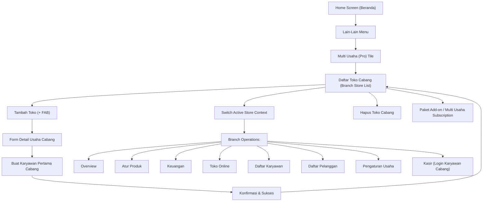

# Comprehensive Test Plan: Multi Usaha (Pro)
**Feature:** Multi Usaha (Branch Store Management)  
**Target Platform:** Android 11 (`emulator-5554`)  
**Application ID:** `com.cloudiex.possaku`  
**Author:** Antigravity QA Automation  
**Date:** 2026-11-18  

---

## 1. Executive Summary & Architecture

The **Multi Usaha (Pro)** feature in Possaku enables multi-outlet businesses to manage multiple branch stores under a single primary account. Each branch operates with isolated or shared operations, including dedicated product catalogs, financial reporting, employee management, online store configurations, customer lists, business settings, and staff-specific cashier logins.

---

## 2. Test Scope & Feature Matrix

| ID | Test Case Name | Feature Module | Priority | Automated |
|---|---|---|:---:|:---:|
| `[MULTI-01]` | Navigasi & Tampilan Daftar Toko Cabang | Branch Store List | P1 | Yes |
| `[MULTI-02]` | Add New Branch Store (`Tambah Toko`) | Branch Store Creation | P1 | Yes |
| `[MULTI-03]` | Add First Employee for Branch Store | Branch Employee Setup | P1 | Yes |
| `[MULTI-04]` | Overview Branch Store Dashboard | Multi Usaha Operations | P1 | Yes |
| `[MULTI-05]` | Atur Produk for Branch Store | Product Catalog Isolation | P1 | Yes |
| `[MULTI-06]` | Keuangan for Branch Store | Financial Reporting | P1 | Yes |
| `[MULTI-07]` | Toko Online for Branch Store | Online Store Isolation | P1 | Yes |
| `[MULTI-08]` | Daftar Karyawan for Branch Store | Branch Employee Directory | P1 | Yes |
| `[MULTI-09]` | Daftar Pelanggan for Branch Store | Branch Customer Management | P1 | Yes |
| `[MULTI-10]` | Pengaturan Usaha for Branch Store | Business Configuration | P1 | Yes |
| `[MULTI-11]` | Kasir (Login Karyawan Cabang) | Employee Login & POS Access | P1 | Yes |
| `[MULTI-12]` | Delete Branch Store | Branch Deletion Lifecycle | P1 | Yes |
| `[MULTI-13]` | Buy Add On Multi Usaha / Subscription | Add-on Management | P2 | Yes |

---

## 3. Detailed Test Cases

### `[MULTI-01]` Navigasi & Tampilan Daftar Toko Cabang
- **Precondition:** User is logged in to Possaku on Android 11.
- **Steps:**
  1. Navigate to `Lain-Lain` menu.
  2. Tap on `Multi Usaha` tile (`point: 222, 1556`).
  3. Verify the screen header displays `Daftar Toko Cabang`.
  4. Verify the list of existing branches (e.g. `Cabang Dua`, `Cabang`) or empty state.
  5. Verify FAB `(+)` button for adding new branch store is visible at bottom-right (`point: 962, 1676`).
- **Expected Result:** Header displays `Daftar Toko Cabang`, branch list is loaded, FAB button is available.

---

### `[MULTI-02]` Add New Branch Store
- **Precondition:** User is on `Daftar Toko Cabang` screen.
- **Steps:**
  1. Tap FAB `(+)` button at `(962, 1676)`.
  2. Verify screen title `Tambah Toko`.
  3. Enter `Nama Usaha` (e.g. `Cabang Otomasi`).
  4. Enter `Deskripsi` (e.g. `Cabang Uji Maestro`).
  5. Tap button `Lanjutkan` (`point: 540, 1667`).
- **Expected Result:** Form inputs accepted, navigates directly to `Buat Karyawan` (Step 2 of branch creation).

---

### `[MULTI-03]` Add First Employee for Branch Store
- **Precondition:** User completed Step 1 of branch store creation and is on `Buat Karyawan`.
- **Steps:**
  1. Enter employee `Nama Lengkap` (e.g. `Kasir Cabang`).
  2. Dismiss soft keyboard via `back`.
  3. Enter employee `Nomor Handphone` (e.g. `081987654321`).
  4. Dismiss soft keyboard via `back`.
  5. Tap `Simpan`.
  6. On confirmation dialog `"Apakah semua informasi sudah benar?"`, tap `Ya`.
  7. Verify success banner `"Selamat Penambahan Karyawan Berhasil"`.
  8. Tap `Kembali Ke Beranda` (`point: 540, 1575`).
- **Expected Result:** Branch store and its first employee are created successfully; user is navigated back.

---

### `[MULTI-04]` Overview Branch Store Dashboard
- **Precondition:** Branch store is created and selected.
- **Steps:**
  1. Access the store overview / dashboard.
  2. Verify branch dashboard metrics (penjualan, transaksi, keuntungan) are displayed for the active branch.
- **Expected Result:** Dashboard metrics correctly reflect the branch store context.

---

### `[MULTI-05]` Atur Produk for Branch Store
- **Precondition:** Branch store is selected.
- **Steps:**
  1. Navigate to `Atur Produk` module.
  2. Verify branch product list is displayed.
  3. Verify products can be assigned or managed specific to the branch store.
- **Expected Result:** Branch-specific product catalog is accessible.

---

### `[MULTI-06]` Keuangan for Branch Store
- **Precondition:** Branch store is selected.
- **Steps:**
  1. Navigate to `Keuangan` module.
  2. Verify financial records (Saku Utama, Laporan Penjualan, Laba Rugi) represent the branch transactions.
- **Expected Result:** Branch financial reports are correctly isolated.

---

### `[MULTI-07]` Toko Online for Branch Store
- **Precondition:** Branch store is selected.
- **Steps:**
  1. Navigate to `Lain-Lain` -> `Toko Online`.
  2. Verify branch online store link and configuration.
  3. Verify store operational hours and phone number for the branch.
- **Expected Result:** Branch online store settings are properly maintained.

---

### `[MULTI-08]` Daftar Karyawan for Branch Store
- **Precondition:** Branch store is selected.
- **Steps:**
  1. Navigate to `Lain-Lain` -> `Daftar Karyawan`.
  2. Verify the first employee created during branch setup (`Kasir Cabang`) is present in the list.
  3. Verify employee role and status.
- **Expected Result:** Branch employee list accurately reflects employees assigned to this branch.

---

### `[MULTI-09]` Daftar Pelanggan for Branch Store
- **Precondition:** Branch store is selected.
- **Steps:**
  1. Navigate to `Lain-Lain` -> `Daftar Pelanggan`.
  2. Verify customer list and debt records for this branch.
- **Expected Result:** Branch customer directory is visible and accessible.

---

### `[MULTI-10]` Pengaturan Usaha for Branch Store
- **Precondition:** Branch store is selected.
- **Steps:**
  1. Navigate to `Usahaku` tab -> `Pengaturan Usaha`.
  2. Verify branch store profile details (store name, owner name, address, tax configuration).
- **Expected Result:** Branch store business settings can be viewed and updated.

---

### `[MULTI-11]` Kasir (Login Karyawan Cabang)
- **Precondition:** Branch employee is active with phone number and PIN.
- **Steps:**
  1. Log out from owner account or switch to staff login.
  2. Input branch employee phone number.
  3. Input default / set PIN (`123456`).
  4. Verify successful login into Kasir screen under the branch context.
- **Expected Result:** Branch cashier is authenticated into the POS module for the branch store.

---

### `[MULTI-12]` Delete Branch Store
- **Precondition:** User is on `Daftar Toko Cabang` screen.
- **Steps:**
  1. Locate the test branch store (e.g. `Cabang Otomasi`).
  2. Tap delete / branch options.
  3. Confirm branch deletion.
  4. Verify branch store is removed from `Daftar Toko Cabang`.
- **Expected Result:** Branch store is successfully deleted and removed from the active branches list.

---

### `[MULTI-13]` Buy Add On Multi Usaha / Subscription
- **Precondition:** User is logged in as owner.
- **Steps:**
  1. Navigate to `Profil` (Tab 4).
  2. Tap `Paket Add-on`.
  3. Verify Multi Usaha add-on status or package info dialog.
- **Expected Result:** Add-on modal/information displays correctly without crashes.

---

## 4. Automated Execution Matrix & Test Reports

| Flow File | Covered Test Cases | Execution Time | Status | Report Link |
| :--- | :--- | :--- | :--- | :--- |
| `flows/lain_lain/multi_usaha_branch_flow.yaml` | `[MULTI-01]`, `[MULTI-02]`, `[MULTI-03]`, `[MULTI-04]` | 1m 57s | **PASSED** | [multi_usaha_branch_report.html](file:///Users/reza/Documents/Reza/PossakuAuto/Possaku_maestro/reports/multi_usaha_branch_report.html) |
| `flows/lain_lain/multi_usaha_modules_flow.yaml` | `[MULTI-05]`, `[MULTI-06]`, `[MULTI-07]`, `[MULTI-08]`, `[MULTI-09]`, `[MULTI-10]` | 1m 35s | **PASSED** | [multi_usaha_modules_report.html](file:///Users/reza/Documents/Reza/PossakuAuto/Possaku_maestro/reports/multi_usaha_modules_report.html) |
| `flows/lain_lain/multi_usaha_login_delete_flow.yaml` | `[MULTI-11]`, `[MULTI-12]`, `[MULTI-13]` | 1m 30s | **PASSED** | [multi_usaha_login_delete_report.html](file:///Users/reza/Documents/Reza/PossakuAuto/Possaku_maestro/reports/multi_usaha_login_delete_report.html) |

**Overall Multi Usaha Automation Status:** 100% Pass Rate (3/3 Flows Passed, 0 Failures).

