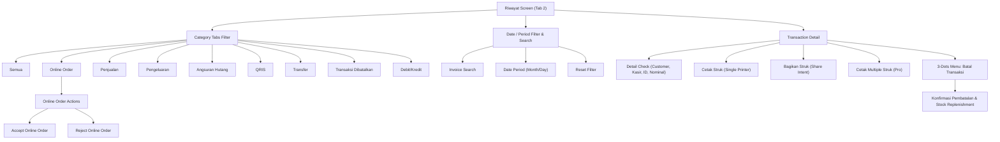

# Comprehensive Test Plan: Riwayat (Transaction History)
**Feature:** Riwayat Transaksi (Transaction History & Receipt Operations)  
**Target Platform:** Android 11 (`emulator-5554`)  
**Application ID:** `com.cloudiex.possaku`  
**Author:** Antigravity QA Automation  
**Date:** 2026-11-19  

---

## 1. Executive Summary & Architecture

The **Riwayat** module is the central ledger of all commercial activities in Possaku. It provides real-time transaction tracking across multiple payment channels, order fulfillment workflows for online sales, debt installment logs, receipt printing/sharing capabilities, and transaction reversal with inventory restock auditing.

---

## 2. Test Scope & Feature Matrix

| ID | Test Case Name | Feature Module | Priority | Automated |
|---|---|---|:---:|:---:|
| `[RIWAYAT-01]` | View All Category Tab (`Semua`) | Tab Navigation | P0 | Yes |
| `[RIWAYAT-02]` | View Online Order Tab (`Online Order`) | Tab Navigation | P1 | Yes |
| `[RIWAYAT-03]` | View Penjualan Tab (`Penjualan`) | Tab Navigation | P0 | Yes |
| `[RIWAYAT-04]` | View Pengeluaran Tab (`Pengeluaran`) | Tab Navigation | P1 | Yes |
| `[RIWAYAT-05]` | View Angsuran Hutang Tab (`Angsuran Hutang`) | Tab Navigation | P1 | Yes |
| `[RIWAYAT-06]` | View QRIS Tab (`QRIS`) | Tab Navigation | P1 | Yes |
| `[RIWAYAT-07]` | View Transfer Tab (`Transfer`) | Tab Navigation | P1 | Yes |
| `[RIWAYAT-08]` | View Transaksi Dibatalkan Tab (`Transaksi Dibatalkan`) | Tab Navigation | P1 | Yes |
| `[RIWAYAT-09]` | View Debit/Kredit Tab (`Debit/Kredit`) | Tab Navigation | P1 | Yes |
| `[RIWAYAT-10]` | Search Invoice by Transaction ID | Search & Filter | P1 | Yes |
| `[RIWAYAT-11]` | Time / Period Filter Selection | Search & Filter | P1 | Yes |
| `[RIWAYAT-12]` | Reset Filter Functionality | Search & Filter | P1 | Yes |
| `[RIWAYAT-13]` | Accept Online Order | Online Order Fulfillment | P1 | Yes |
| `[RIWAYAT-14]` | Reject Online Order | Online Order Fulfillment | P1 | Yes |
| `[RIWAYAT-15]` | Print Single Struk | Receipt Operations | P0 | Yes |
| `[RIWAYAT-16]` | Share Struk via System Intent | Receipt Operations | P1 | Yes |
| `[RIWAYAT-17]` | Print Multiple Struk (Pro) | Receipt Operations | P2 | Yes |
| `[RIWAYAT-18]` | Cancel Transaction & Verify Stock Return | Transaction Lifecycle | P0 | Yes |
| `[RIWAYAT-19]` | Detail Check for Customer Name & Meta | Transaction Details | P1 | Yes |

---

## 3. Detailed Test Cases

### `[RIWAYAT-01]` View All Category Tab (`Semua`)
- **Precondition:** User is logged in and on the Possaku dashboard.
- **Steps:**
  1. Tap bottom navigation `Riwayat\nTab 2 dari 4`.
  2. Verify screen header displays `Riwayat` and active period (e.g. `Nov 2026`).
  3. Ensure default selected tab is `Semua`.
  4. Verify transaction list displays all transaction types (Cash, Debt, QRIS, Expenses).
- **Expected Result:** `Semua` tab is active and shows combined historical transaction entries.

---

### `[RIWAYAT-02]` View Online Order Tab (`Online Order`)
- **Precondition:** User is on the `Riwayat` screen.
- **Steps:**
  1. Tap tab `Online Order`.
  2. Verify transaction list filters to display incoming and past web/online orders.
  3. If empty, verify friendly empty-state illustration or message.
- **Expected Result:** Only orders from online channels are visible.

---

### `[RIWAYAT-03]` View Penjualan Tab (`Penjualan`)
- **Precondition:** User is on the `Riwayat` screen.
- **Steps:**
  1. Tap tab `Penjualan`.
  2. Verify list displays POS sales transactions with green positive income indicators (`+Rp...`).
- **Expected Result:** Transaction list contains completed direct sales records.

---

### `[RIWAYAT-04]` View Pengeluaran Tab (`Pengeluaran`)
- **Precondition:** User is on the `Riwayat` screen.
- **Steps:**
  1. Swipe tabs horizontally and tap `Pengeluaran`.
  2. Verify list displays operational expenses with negative indicators (`-Rp...`).
- **Expected Result:** Transaction list contains business expense vouchers.

---

### `[RIWAYAT-05]` View Angsuran Hutang Tab (`Angsuran Hutang`)
- **Precondition:** User is on the `Riwayat` screen.
- **Steps:**
  1. Swipe tabs horizontally and tap `Angsuran Hutang`.
  2. Verify list displays debt installment entries with prefix `DEBT.INV...`.
- **Expected Result:** Only debt installment transactions are displayed.

---

### `[RIWAYAT-06]` View QRIS Tab (`QRIS`)
- **Precondition:** User is on the `Riwayat` screen.
- **Steps:**
  1. Swipe tabs horizontally and tap `QRIS`.
  2. Verify list displays transactions processed through QRIS digital payments.
- **Expected Result:** QRIS payment records are correctly filtered.

---

### `[RIWAYAT-07]` View Transfer Tab (`Transfer`)
- **Precondition:** User is on the `Riwayat` screen.
- **Steps:**
  1. Swipe tabs horizontally and tap `Transfer`.
  2. Verify list displays bank transfer transactions.
- **Expected Result:** Bank transfer records are isolated.

---

### `[RIWAYAT-08]` View Transaksi Dibatalkan Tab (`Transaksi Dibatalkan`)
- **Precondition:** User is on the `Riwayat` screen.
- **Steps:**
  1. Swipe tabs horizontally and tap `Transaksi Dibatalkan`.
  2. Verify list displays voided/cancelled transactions with `Batal` badges.
- **Expected Result:** Cancelled transactions are clearly marked and segregated from revenue.

---

### `[RIWAYAT-09]` View Debit/Kredit Tab (`Debit/Kredit`)
- **Precondition:** User is on the `Riwayat` screen.
- **Steps:**
  1. Swipe tabs horizontally and tap `Debit/Kredit`.
  2. Verify list displays card EDC transactions (Debit/Credit).
- **Expected Result:** Card payment transactions are listed.

---

### `[RIWAYAT-10]` Search Invoice by Transaction ID
- **Precondition:** User is on the `Riwayat` screen.
- **Steps:**
  1. Tap search icon or search bar.
  2. Input invoice ID or partial ID (e.g. `INV1811`).
  3. Verify the filtered list immediately presents only matching invoices.
- **Expected Result:** Search query filters list accurately without crash or blank screen.

---

### `[RIWAYAT-11]` Time / Period Filter Selection
- **Precondition:** User is on the `Riwayat` screen.
- **Steps:**
  1. Tap period selector header (e.g. `Menampilkan Nov 2026`).
  2. Select alternate period (e.g. `Bulan Ini`, `Hari Ini`, `7 Hari Terakhir`, or custom date range).
  3. Tap `Terapkan` / confirm.
- **Expected Result:** List updates to reflect only transactions matching the chosen date range.

---

### `[RIWAYAT-12]` Reset Filter Functionality
- **Precondition:** A category filter or date filter has been applied on `Riwayat`.
- **Steps:**
  1. Tap `Reset` button (`[775,276][1028,381]`).
  2. Verify all active filters clear.
  3. Verify tab returns to `Semua` and period returns to current default.
- **Expected Result:** Transaction list reverts to the default complete dataset.

---

### `[RIWAYAT-13]` Accept Online Order
- **Precondition:** At least one incoming order exists under `Online Order` tab with status `Pesanan Baru`.
- **Steps:**
  1. Select the pending online order.
  2. On order detail, tap `Terima Pesanan`.
  3. Verify confirmation and status update to `Diproses` / `Selesai`.
- **Expected Result:** Order status transitions successfully.

---

### `[RIWAYAT-14]` Reject Online Order
- **Precondition:** Incoming order exists under `Online Order` tab.
- **Steps:**
  1. Select the pending online order.
  2. Tap `Tolak Pesanan`.
  3. Provide or select reason for rejection.
  4. Confirm rejection.
- **Expected Result:** Order status updates to `Ditolak` and customer/order status reflects cancellation.

---

### `[RIWAYAT-15]` Print Single Struk
- **Precondition:** User is on the `Detail Transaksi` screen of a completed sale.
- **Steps:**
  1. Tap `Cetak Struk` button (`[553,1416][1028,1566]`).
  2. If printer is not connected, verify `Pilih Printer` dialog / prompt appears gracefully.
  3. If printer is configured, verify print job dispatch.
- **Expected Result:** Print action triggers printer connection dialog or successful print output.

---

### `[RIWAYAT-16]` Share Struk via System Intent
- **Precondition:** User is on the `Detail Transaksi` screen.
- **Steps:**
  1. Tap `Bagikan Struk` button (`[53,1416][527,1566]`).
  2. Verify Android system share sheet (Share via WhatsApp, Image, PDF, etc.) appears.
  3. Dismiss share dialog via back key.
- **Expected Result:** Android share intent opens with rendered receipt image/text.

---

### `[RIWAYAT-17]` Print Multiple Struk (Pro)
- **Precondition:** User has Pro features enabled or tests multi-receipt option.
- **Steps:**
  1. In receipt printing configuration or multi-print mode, select multiple copies (e.g. 2x for Customer + Kitchen).
  2. Tap `Cetak Struk`.
- **Expected Result:** Multi-copy receipt execution handles queue without stalling.

---

### `[RIWAYAT-18]` Cancel Transaction & Verify Stock Return
- **Precondition:** Note current stock of item `beras oye` (e.g. 50 units). Create sale of 1 unit.
- **Steps:**
  1. Open the transaction in `Riwayat`.
  2. Tap 3-dots menu button at top right (`point: 1017, 136`).
  3. Tap `Batal Transaksi` on bottom sheet.
  4. On confirmation dialog `"Konfirmasi\nIngin membatalkan transaksi?"`, tap `Ya`.
  5. Verify transaction status changes to `Dibatalkan` / item is moved to `Transaksi Dibatalkan`.
  6. Navigate to `Atur Produk` and verify product stock has returned (increased by 1 unit).
- **Expected Result:** Transaction is voided and inventory stock is automatically replenished.

---

### `[RIWAYAT-19]` Detail Check for Customer Name & Meta
- **Precondition:** User opens a transaction record.
- **Steps:**
  1. Verify `Transaksi Sukses` header is displayed.
  2. Verify `ID Trans` matches invoice format (e.g. `INV...`).
  3. Verify `Pelanggan` (Customer Name) is displayed accurately (or `-` if guest).
  4. Verify `Kasir` displays cashier name.
  5. Verify product itemization, unit price, quantity, and subtotal match the final payment.
- **Expected Result:** All transaction metadata fields are correctly populated and aligned.
