# Comprehensive Test Plan: Usahaku (Store Operations & Settings)
**Feature:** Usahaku (My Business Settings & Store Operations)  
**Target Platform:** Android 11 (`emulator-5554`)  
**Application ID:** `com.cloudiex.possaku`  
**Author:** Antigravity QA Automation  
**Date:** 2026-11-19  

---

## 1. Executive Summary & Architecture

The **Usahaku** module enables merchants to configure core operational parameters: toggling live store operating state (Buka/Tutup), updating legal and business identity, managing PPN / tax parameters, provisioning QRIS digital payment destinations, customizing thermal receipts, and categorizing business operations using community tags.

```mermaid
flowchart TD
    A["Usahaku Screen (Tab 3)"] --> B["Store Status Toggle"]
    B --> B1["Buka Usaha (Open)"]
    B --> B2["Tutup Usaha (Close)"]
    A --> C["Informasi Usaha"]
    C --> C1["Edit Store Name, Owner, Address, Phone"]
    A --> D["Pajak (Tax Settings)"]
    D --> D1["Activate Tax (PPN Active)"]
    D --> D2["Deactivate Tax (PPN Inactive)"]
    A --> E["Informasi QR Code / QRIS"]
    E --> E1["View QRIS Info & Guide"]
    E --> E2["Add New QRIS / Bank Account"]
    E --> E3["Edit QRIS Details"]
    E --> E4["Share QRIS"]
    E --> E5["Delete QRIS"]
    A --> F["Atur Struk (Receipt Settings)"]
    F --> F1["Upload Logo & Set Info"]
    F --> F2["Preview Custom Receipt"]
    A --> G["Tag Usaha (Business Categories)"]
    G --> G1["Search Existing Tags"]
    G --> G2["Add New Community Tag"]
    G --> G3["Select / Attach Tag"]
    G --> G4["Delete / Remove Tag"]
```

---

## 2. Test Scope & Feature Matrix

| ID | Test Case Name | Feature Module | Priority | Automated |
|---|---|---|:---:|:---:|
| `[USAHAKU-01]` | Open Store (`Buka Usaha`) | Store Status | P0 | Yes |
| `[USAHAKU-02]` | Close Store (`Tutup Usaha`) | Store Status | P0 | Yes |
| `[USAHAKU-03]` | Change Store Information (`Informasi Usaha -> Ubah`) | Store Profile | P1 | Yes |
| `[USAHAKU-04]` | Activated Tax (`Pajak Aktif`) | Tax Configuration | P1 | Yes |
| `[USAHAKU-05]` | Deactivated Tax (`Pajak Tidak Aktif`) | Tax Configuration | P1 | Yes |
| `[USAHAKU-06]` | View QRIS Information & Comparison Guide | QRIS Management | P2 | Yes |
| `[USAHAKU-07]` | Add New QRIS / Bank Account (`Tambah QRIS`) | QRIS Management | P1 | Yes |
| `[USAHAKU-08]` | Delete QRIS Configuration (`Hapus QRIS`) | QRIS Management | P1 | Yes |
| `[USAHAKU-09]` | Edit QRIS Details (`Ubah QRIS`) | QRIS Management | P1 | Yes |
| `[USAHAKU-10]` | Share QRIS Image / Data (`Bagikan QRIS`) | QRIS Management | P2 | Yes |
| `[USAHAKU-11]` | Edit Custom Receipt (`Atur Struk Kostum`) | Receipt Customization | P1 | Yes |
| `[USAHAKU-12]` | Preview Custom Receipt (`Preview Struk`) | Receipt Customization | P1 | Yes |
| `[USAHAKU-13]` | Attach Tag Usaha to Store | Business Tags | P2 | Yes |
| `[USAHAKU-14]` | Add New Tag Usaha (`Tag Baru`) | Business Tags | P1 | Yes |
| `[USAHAKU-15]` | Search Business Tags (`Cari Tag`) | Business Tags | P1 | Yes |
| `[USAHAKU-16]` | Delete / Detach Business Tag | Business Tags | P2 | Yes |

---

## 3. Detailed Test Cases

### `[USAHAKU-01]` Open Store (`Buka Usaha`)
- **Precondition:** Store status is currently Closed (`Tutup`).
- **Steps:**
  1. Navigate to `Usahaku` Tab (`Tab 3 dari 4`).
  2. Tap store status switch (`point: 878, 341`).
  3. On confirmation dialog `"Buka Usaha"`, tap `Ya`.
  4. Navigate to `Home` (`Tab 1`).
  5. Verify store status badge shows `Buka`.
- **Expected Result:** Store status changes to Open and operational hours indicate active trading.

---

### `[USAHAKU-02]` Close Store (`Tutup Usaha`)
- **Precondition:** Store status is currently Open (`Buka`).
- **Steps:**
  1. Navigate to `Usahaku` Tab.
  2. Tap store status switch (`point: 878, 341`).
  3. On confirmation dialog `"Tutup Usaha"`, tap `Ya`.
  4. Navigate to `Home` (`Tab 1`).
  5. Verify store status badge shows `Tutup`.
- **Expected Result:** Store status changes to Closed and online orders/POS reflect closed hours.

---

### `[USAHAKU-03]` Change Store Information (`Informasi Usaha -> Ubah`)
- **Precondition:** User is on the `Usahaku` screen.
- **Steps:**
  1. Tap `Ubah` button next to `Informasi Usaha` (`point: 917, 585` or `tapOn: Ubah`).
  2. Update store name, owner name, business location, or telephone number.
  3. Tap `Simpan`.
  4. Verify updated values are reflected on `Usahaku` overview.
- **Expected Result:** Store profile changes persist and display correctly.

---

### `[USAHAKU-04]` Activated Tax (`Pajak Aktif`)
- **Precondition:** Tax is currently inactive (`Pajak (Tidak Aktif)`).
- **Steps:**
  1. On `Usahaku` screen, tap `Pajak` card (`[53,854][1028,1056]`).
  2. Verify screen title `Atur Pajak`.
  3. Toggle tax switch to active (`point: 985, 231`).
  4. Set tax percentage (default `10.0%`).
  5. Tap `Simpan`.
  6. On success dialog `"Info Pajak Anda berhasil diperbarui"`, tap `Tutup`.
  7. Return to `Usahaku` and verify label displays `Pajak (Aktif sejak...)`.
- **Expected Result:** Tax is activated and applies to future checkout calculations.

---

### `[USAHAKU-05]` Deactivated Tax (`Pajak Tidak Aktif`)
- **Precondition:** Tax is currently active (`Pajak (Aktif)`).
- **Steps:**
  1. Tap `Pajak` card.
  2. Toggle tax switch to inactive (`point: 985, 231`).
  3. Tap `Simpan`.
  4. Dismiss success dialog.
  5. Return to `Usahaku` and verify label displays `Pajak (Tidak Aktif)`.
- **Expected Result:** Tax is deactivated and orders calculate zero tax.

---

### `[USAHAKU-06]` View QRIS Information & Comparison Guide
- **Precondition:** User is on `Usahaku` screen.
- **Steps:**
  1. Tap `Informasi QR Code` card (`[53,1077][1028,1222]`).
  2. Verify screen header `Atur QRIS/Rekening`.
  3. Tap `Tampilkan perbedaan QRIS Toko dan QRIS Personal >`.
  4. Verify comparison modal/sheet displays key differences.
  5. Close guide.
- **Expected Result:** Educational QRIS information displays accurately.

---

### `[USAHAKU-07]` Add New QRIS / Bank Account (`Tambah QRIS`)
- **Precondition:** User is on `Atur QRIS/Rekening` screen.
- **Steps:**
  1. Tap `(+)` button in header (`point: 996, 136`).
  2. Verify screen title `Tambah QRIS/Rekening`.
  3. Select provider `Pilih Penyedia QRIS` (e.g. `BCA`, `Gopay`, `Dana`).
  4. Enter `Atas Nama` (e.g. `Toko Berkah`).
  5. Enter `Nomor Rekening / HP` (e.g. `1234567890`).
  6. Tap `Simpan`.
- **Expected Result:** New QRIS / bank account is created and listed under payment channels.

---

### `[USAHAKU-08]` Delete QRIS Configuration (`Hapus QRIS`)
- **Precondition:** At least one QRIS / bank account exists.
- **Steps:**
  1. On QRIS card, tap delete / trash icon or long-press.
  2. Confirm deletion dialog (`Ya`).
  3. Verify QRIS is removed from list.
- **Expected Result:** Account is removed gracefully.

---

### `[USAHAKU-09]` Edit QRIS Details (`Ubah QRIS`)
- **Precondition:** An existing QRIS record is available.
- **Steps:**
  1. Tap on the QRIS card or edit button.
  2. Update beneficiary name or account number.
  3. Tap `Simpan`.
- **Expected Result:** Changes to the QRIS configuration are saved.

---

### `[USAHAKU-10]` Share QRIS Image / Data (`Bagikan QRIS`)
- **Precondition:** QRIS image or code exists.
- **Steps:**
  1. Tap `Bagikan QRIS` or share icon.
  2. Verify system share sheet opens.
  3. Dismiss sheet.
- **Expected Result:** QR code image can be shared to external apps.

---

### `[USAHAKU-11]` Edit Custom Receipt (`Atur Struk Kostum`)
- **Precondition:** User is on `Usahaku` screen.
- **Steps:**
  1. Tap `Atur Struk` card (`[53,1419][1028,1563]`).
  2. Verify screen title `Atur Struk Kostum`.
  3. Enter custom `Nama Toko`, `Informasi Alamat`, and `Nomor Telepon`.
  4. Tap `Simpan`.
- **Expected Result:** Custom receipt fields are saved and persist across sessions.

---

### `[USAHAKU-12]` Preview Custom Receipt (`Preview Struk`)
- **Precondition:** User is on `Atur Struk Kostum` screen.
- **Steps:**
  1. Tap `Preview` button (`[53,1592][1028,1742]`).
  2. Verify receipt simulation modal renders with store name, address, phone, sample items, subtotal, and powered-by footer.
  3. Press back key to dismiss preview.
- **Expected Result:** Real-time visual receipt preview accurately reflects custom inputs.

---

### `[USAHAKU-13]` Attach Tag Usaha to Store
- **Precondition:** User is on `Usahaku` screen.
- **Steps:**
  1. Tap `Tag Usaha` card (`[53,1243][1028,1398]`).
  2. Verify screen title `Tag`.
  3. Select a community tag (e.g. `Toko Kelontong`).
  4. Tap `Simpan`.
- **Expected Result:** Selected tag is attached to store profile.

---

### `[USAHAKU-14]` Add New Tag Usaha (`Tag Baru`)
- **Precondition:** User is on `Tag` screen.
- **Steps:**
  1. Tap `(+)` button in header (`point: 996, 136`).
  2. Verify dialog `Tag Baru`.
  3. Input tag name in `Nama Tag` field (e.g. `Warung Kopi`).
  4. Tap `Simpan`.
- **Expected Result:** New tag is created and added to the tag list.

---

### `[USAHAKU-15]` Search Business Tags (`Cari Tag`)
- **Precondition:** User is on `Tag` screen.
- **Steps:**
  1. Tap `Cari Tag` search bar.
  2. Type search keyword (e.g. `Baju`).
  3. Verify list filters to show matching tags (e.g. `Toko Baju`, `Baju Muslim`).
- **Expected Result:** Search instantly filters tags according to keyword.

---

### `[USAHAKU-16]` Delete / Detach Business Tag
- **Precondition:** A tag is currently assigned to the business.
- **Steps:**
  1. Deselect or remove the tag on `Tag` screen.
  2. Tap `Simpan`.
- **Expected Result:** Store tag is cleared or updated.
